# Feel pass report: three moments

A small pass on how three moments feel: answering, finishing a session, and coming back after a break. No new screens, no mascot, no streaks and no new dependencies; the motion is CSS only. Decisions are D-348 to D-353 in [DECISIONS.md](./DECISIONS.md).

## What changed

### 1. Answer feedback (review screen)

- **Show answer / Check:** the answer area fades and slides in over 150ms, below the question. Nothing above it moves; a test checks the question's position is unchanged.
- **MCQ, right:** ✓ on the chosen option, a 1.00 → 1.02 → 1.00 scale over 180ms, and "✓ Correct" below with the explanation.
- **MCQ, wrong:** ✗ on your choice and ✓ on the answer, then "✗ Not quite — here's why." and the explanation.
  - The copy is in the normal text colour; only the ✗ is red, and there's no red background. Without an explanation it says just "Not quite."
  - Each option keeps a 20px slot for its ✓ or ✗, so marking one never reflows its text. "Correct answer" and "Your answer" are now screen-reader text inside the option.
- **Cloze, typed:** the same pattern. The filled-in word gets the pop when right; "Answer:" and "You typed:" show when wrong.
- **Rating:** the button shows pressed for 80ms (also when you used its key), the card fades out over 120ms, and the next one comes in over 120ms.
- **Input is never blocked.** The next card replaces the leaving one as soon as it has loaded. Shortcut keys go into a queue and apply in order, each against what's on screen, including while a rating saves.
  - **Found on the way:** before this, a key typed fast was checked against the card as it was before the previous key. A rating pressed right after Space saw an unrevealed card and was dropped. The new E2E caught it.

### 2. Session complete

- **The ring:** it draws in, then its check (400ms in all). No confetti.
- **Only true numbers, from the stored reviews and the scheduler's states:**
  - "You reviewed N cards in about M minutes." (unchanged)
  - "Remembered X of N": ratings other than Again or, for checked MCQ and typed cloze answers, whether the answer was right.
  - "Next: 9 due tomorrow". Cards still in today's queue now say "Next: 25 still due today"; before, overdue cards read "45 later today", which wasn't true.
  - "K cards won't come back for 2+ weeks.", only when K > 0. It counts this session's cards whose scheduled due date is 14+ days away.

### 3. Coming back after a break

- **Trigger:** the last review that wasn't undone was 2+ study days ago, more than 30 cards are due, and the user has reviewed before. The rule is exact in D-349, with unit tests.
- **Home shows:** "Welcome back. 45 cards are waiting — nothing is lost." Primary: **Start with 20**. Secondary: **Review all 45**. Space does the primary.
- **Start with 20:** the 20 most overdue due cards, fixed when the session starts. No new cards. It's a session limit only: no card's schedule changes, which unit tests and E2E check.
- **After a capped session:** **Do 20 more** and **Done for today**, styled exactly alike. "Do N more" never offers more than are left.

### Events and analytics

- **New events:** `break_return_shown {due, daysAway}` (once per study day) and `capped_session_started {cap, due}`. Numbers only, no card text; the core test still rejects any free-text prop.
- **Query `break_return_sessions`** in `apps/api/analytics.sql`: of the users shown "Welcome back", how many started a session within 24 hours, capped vs full, as counts and shares. Tested on a hand-built fixture in `analyticsBreak.test.ts`.
- **Old apps keep syncing.** An app rejects event types it doesn't know, so one new event would have failed the whole pull on a device still running the previous version.
  - Pulls now declare the event types they understand (`eventsVersion`); apps that send nothing get only the M8 types.
  - Additive, no protocol bump, no "Update required" (D-348).

## Before and after

Phone (390×844). Stills use reduced motion, so they show the settled state; the recordings play at real speed, dark theme. Light-theme stills are next to each file (`-light.png`).

| Moment                      | Before                                                      | After                                                      |
| --------------------------- | ----------------------------------------------------------- | ---------------------------------------------------------- |
| Answer shown                |     | 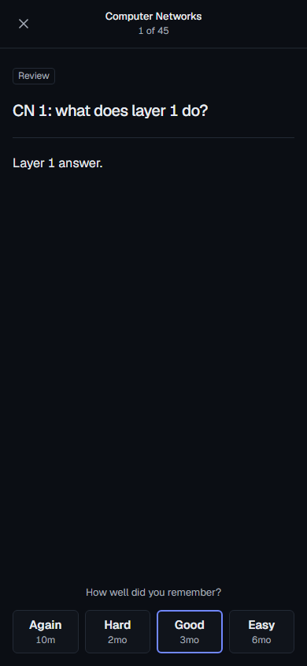    |
| MCQ right                   | 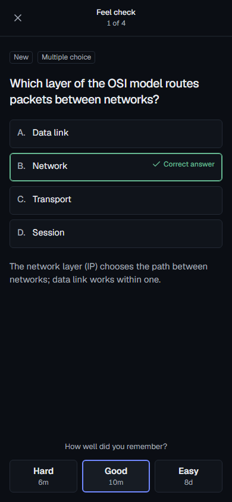       | 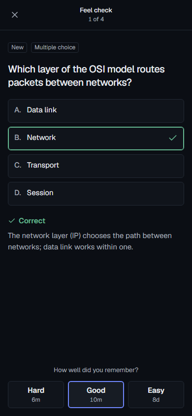       |
| MCQ wrong                   | 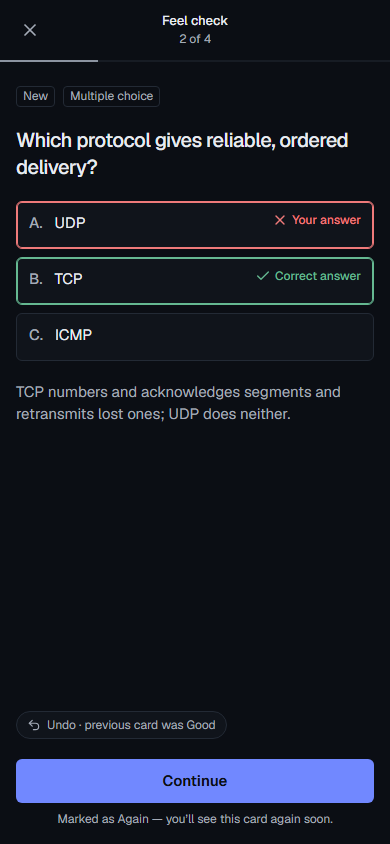         | 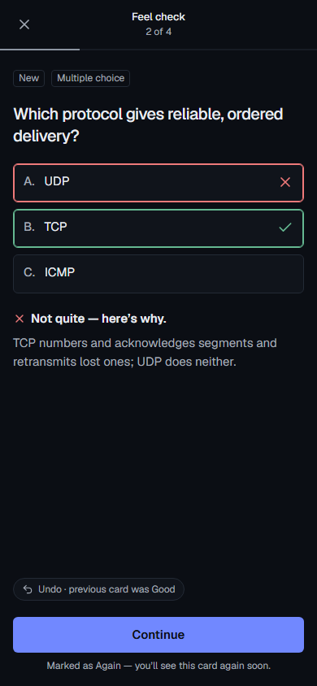         |
| Cloze right                 | 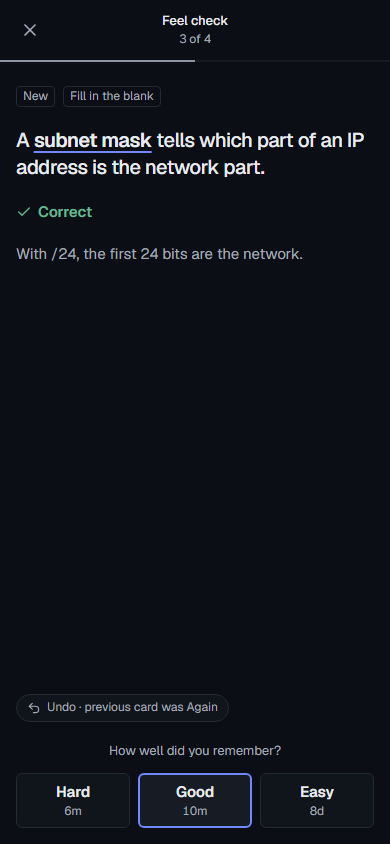     |      |
| Cloze wrong                 | 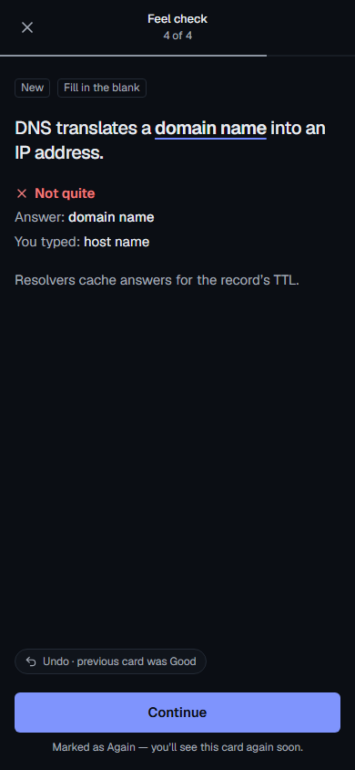       | 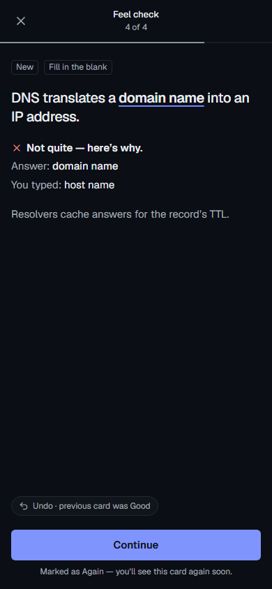       |
| Session complete            | 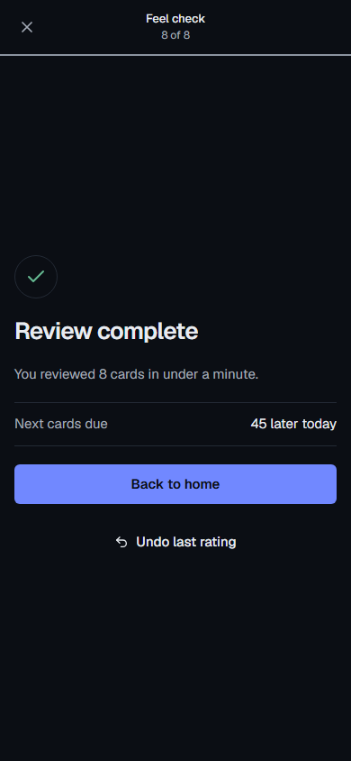          | 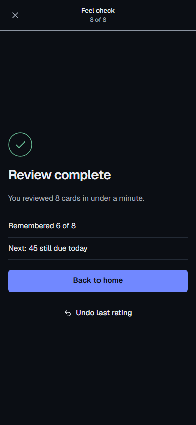          |
| Home after a break          | 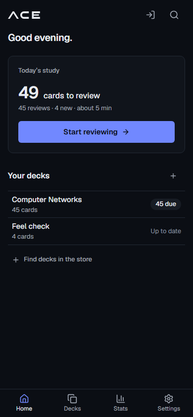  | 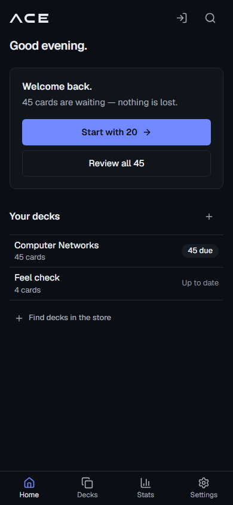  |
| After "Start with 20" (new) | —                                                           | 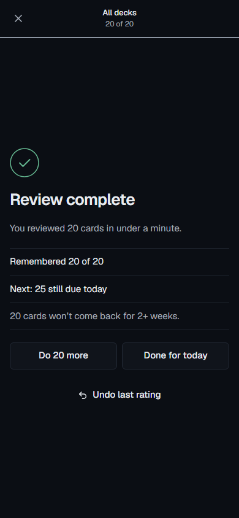   |
| Home after a break, light   | 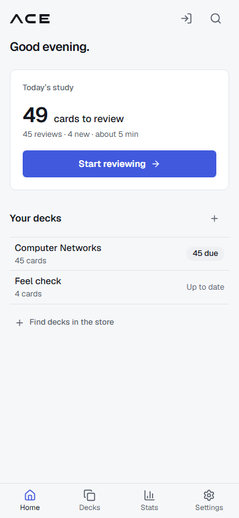 | 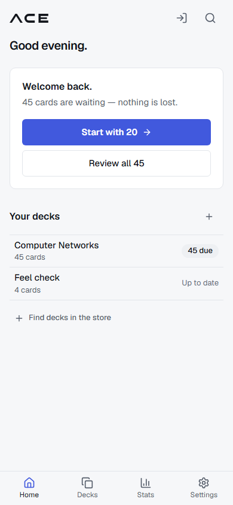 |

### Recordings

| Moment                                                     | Before                                                                     | After                                                                     |
| ---------------------------------------------------------- | -------------------------------------------------------------------------- | ------------------------------------------------------------------------- |
| Show answer, rate, next card (×3)                          | [reveal-and-rate.webm](docs/ui-design/feel/_before/reveal-and-rate.webm)   | [reveal-and-rate.webm](docs/ui-design/feel/_after/reveal-and-rate.webm)   |
| MCQ right, MCQ wrong, cloze right, cloze wrong             | [answer-feedback.webm](docs/ui-design/feel/_before/answer-feedback.webm)   | [answer-feedback.webm](docs/ui-design/feel/_after/answer-feedback.webm)   |
| Last card → session complete                               | [session-complete.webm](docs/ui-design/feel/_before/session-complete.webm) | [session-complete.webm](docs/ui-design/feel/_after/session-complete.webm) |
| Home after a break → Start with 20 → 20 cards → Do 20 more | [break-return.webm](docs/ui-design/feel/_before/break-return.webm)         | [break-return.webm](docs/ui-design/feel/_after/break-return.webm)         |

To recapture: `FEEL_CAPTURE=1 FEEL_DIR=_after pnpm --filter @recall/web exec playwright test e2e/feel-capture.spec.ts`.

## Proof per requirement

| Requirement                                                   | Where it's checked                                                                                                                                 |
| ------------------------------------------------------------- | -------------------------------------------------------------------------------------------------------------------------------------------------- |
| Answer fades/slides in over 150ms, no layout jump             | `feel.spec.ts` › "Show answer…": animation `feel-in` 0.15s, question position unchanged; MCQ option height unchanged after Check                   |
| MCQ ✓ + 1.02 pop + "Correct"; wrong ✗/✓, explanation, neutral | `feel.spec.ts` › "answer feedback…": pop class only on the right choice, same background as an unmarked option, verdict in the text colour         |
| Cloze: same pattern                                           | same test                                                                                                                                          |
| Rating: 80ms pressed, 120ms out, next in                      | `index.css` (`card-leaving`, `animate-card-in`), `ReviewScreen.tsx` (`data-pressed`); recordings                                                   |
| No animation delays the next card; keys apply immediately     | `feel.spec.ts` › "rating 10 cards quickly…": 20 key presses with no waits; all 10 reviews stored, in order, with the right ratings                 |
| Check ring draws over 400ms, no confetti                      | `CheckRing` (300ms ring + 200ms check from 200ms); `feel.spec.ts` › "session complete…"                                                            |
| Only true numbers                                             | `feel.test.ts` (remembered rule, far-off from card states, copy); `feel.spec.ts` checks "Remembered 4 of 5" and the 2-weeks line against IndexedDB |
| Trigger: ≥ 2 study days and > 30 due                          | `feel.test.ts` › "coming back after a break: the trigger" (30 vs 31, 1 vs 2 days, rollover hour, never reviewed, undone review)                    |
| Capped queue: 20, most overdue first, schedule unchanged      | `feel.test.ts` › "capped sessions" (states and the uncapped queue identical); `feel.spec.ts` (the 25 left out are byte-identical)                  |
| Do 20 more / Done for today, neither emphasised               | `feel.spec.ts`: same class on both, no "Back to home"                                                                                              |
| Reduced motion → instant                                      | `feel.spec.ts` › "reduced motion…": every animation/transition duration and delay on the page is 0s                                                |
| Axe clean, both themes                                        | `feel.spec.ts` › "axe · dark/light" (welcome back, MCQ right and wrong, cloze wrong, complete, capped complete) plus the existing `a11y.spec.ts`   |
| Events without card text; analytics query                     | core `events.test.ts`; API `events.test.ts` (old apps never pull the new types); `analyticsBreak.test.ts`                                          |

## Tests

- `pnpm check`: green — core 329, API 131, web 305.
- `pnpm e2e`: 77 passed, 11 skipped (the opt-in screenshot and capture specs).
- **Tests changed (copy changes, none weakened):**
  - `presentation.test.ts`: the "Next cards due" copy became "Next: … due …".
  - `sync.test.ts` (core): the parsed pull query now includes `eventsVersion: 1`.
  - `overview.test.ts`: the home data now includes `breakReturn: null`.

## What I chose not to change

- **"You reviewed N cards" counts reviews, as before**, so a card seen twice counts twice; "Remembered X of N" uses the same N, so the two always agree.
- **No sound or haptics.** Neither was asked for, and both would need a setting.
- **The undo pill and Continue button keep their existing motion.** Only the rating buttons got the pressed state the brief describes.
