# UI polish report: Ace rebrand and polish pass

_Branch `ui-polish`. Built overnight, 11 Oct 2026, per the overnight brief._

## Summary

- **Rebrand:** the app is **Ace** everywhere a user looks: tab title, install name, icon, wordmark, welcome, Settings and the sign-in email.
  - Packages, the repo and the databases keep `recall`.
  - The manifest has icons 192, 512 and maskable 512 (`purpose: "maskable"`), with theme and background `#0B0E14`. The favicons and apple-touch-icon are linked.
  - The service worker precaches all the icons, and Chrome reports no installability errors.
- **Polish:** a refinement of the existing look, not a new one. Geist, the indigo accent and the semantic token names stay. The pass changed tokens, then components, then screens:
  - **Calmer and denser:** the type scale is a step smaller, with a true 4px spacing base and 6/10 radii.
  - **Surfaces:** neutral cool surfaces on `#0B0E14`, hairline borders, and shadows only on overlays.
  - **Accent:** reserved for primary actions, focus and selection.
- **Found on the way:** every "44px" touch target was really **41px**. The root font size of 15px had put all spacing on a 3.75px base. It's fixed, and a new E2E guard keeps it fixed (D-345, D-347).
- **Unchanged:** behaviour, keyboard shortcuts, offline, sync, the API and the database. The one exception is the email sender name, which the rebrand asked for. Every E2E selector and every test is kept; one assertion moved from visible text to screen-reader text (see below).

## Before and after

All screens, at 390×844 and 1280×800, in dark and light: `docs/ui-design/_before/` and `docs/ui-design/_after/`, 148 images each, same names. These pairs show the most change:

| Screen                     | Before                                                          | After                                                          |
| -------------------------- | --------------------------------------------------------------- | -------------------------------------------------------------- |
| Home, desktop dark         | 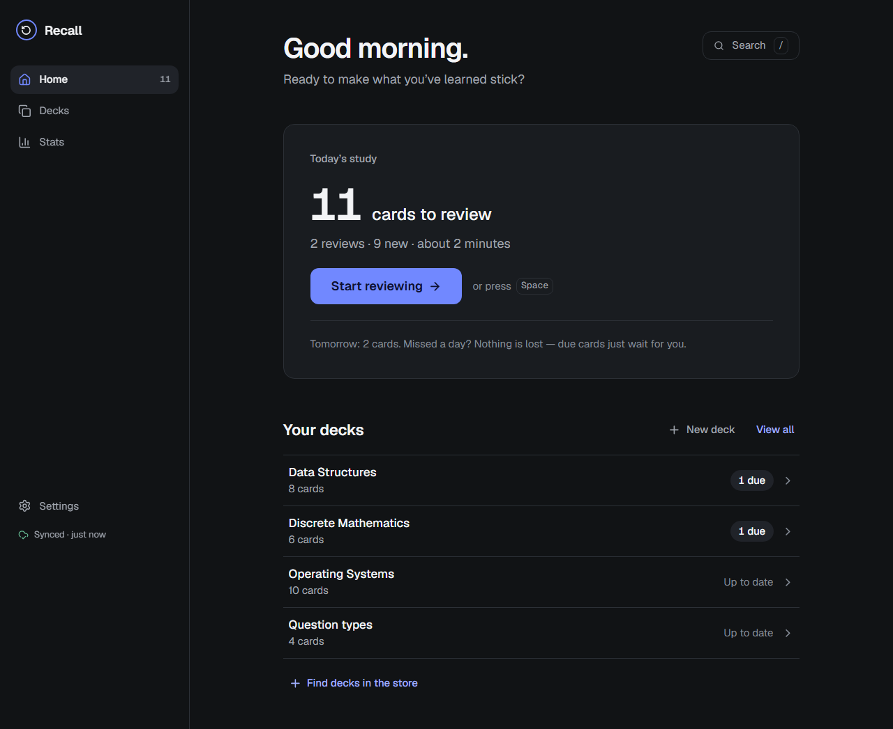               | 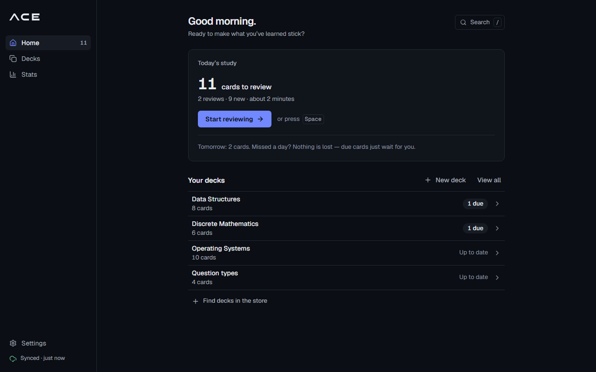               |
| Home, phone light          | 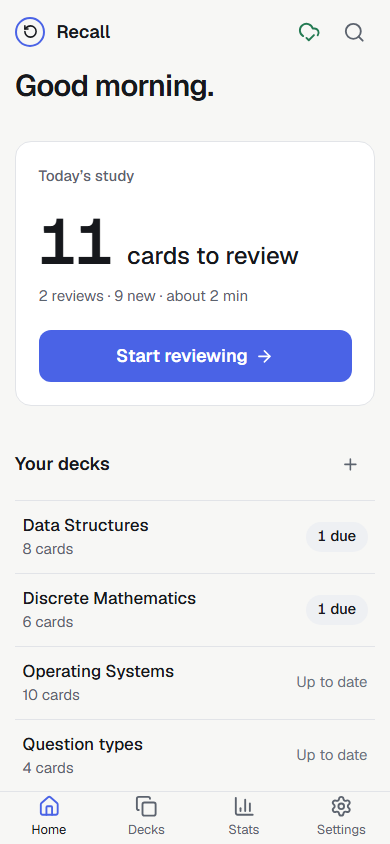               | 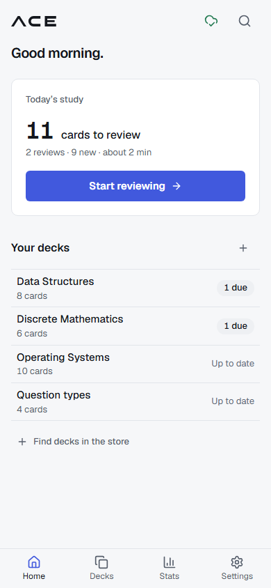               |
| Review, answer, phone dark | 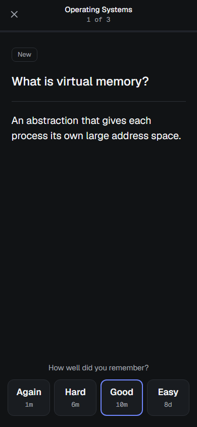     | 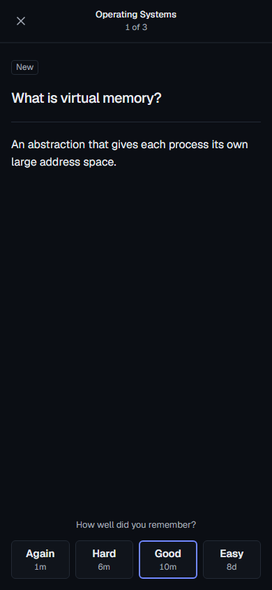     |
| Long answer, desktop light | 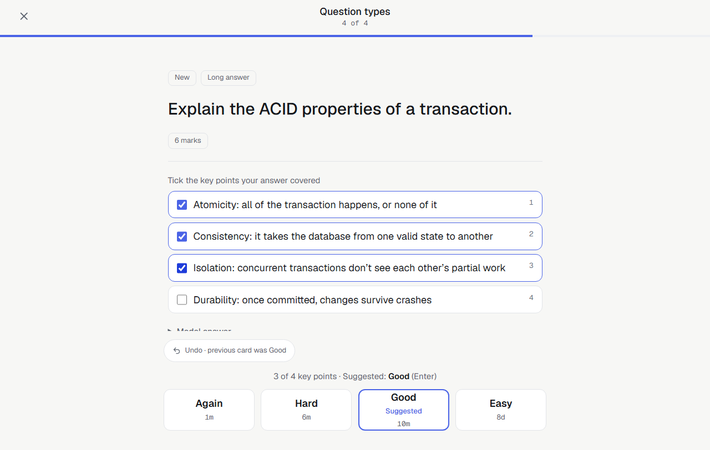 | 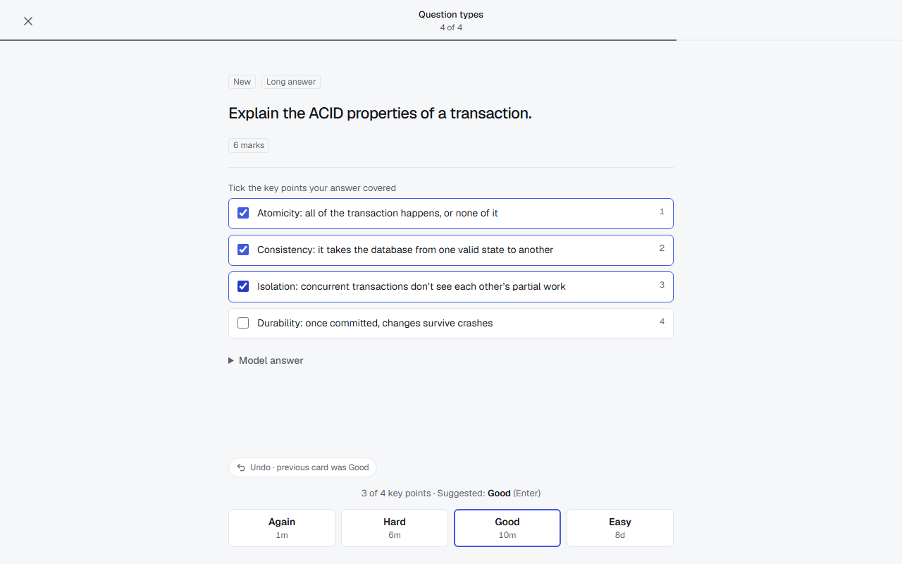 |
| Store, phone dark          | 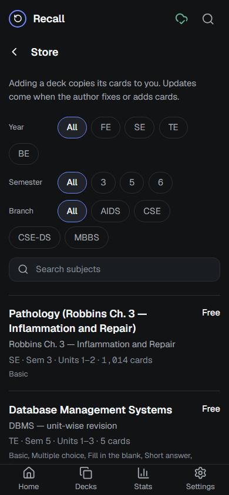               | 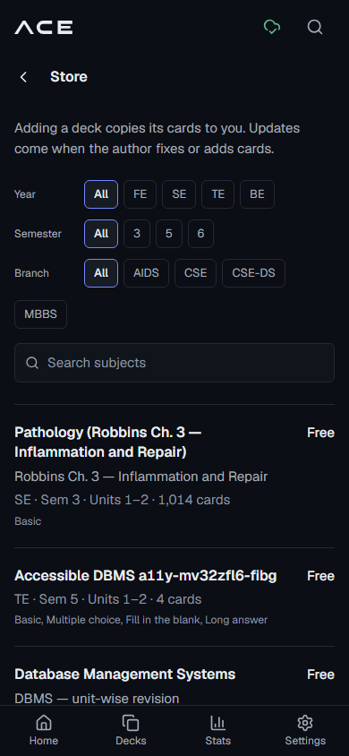               |
| Store deck page, desktop   | 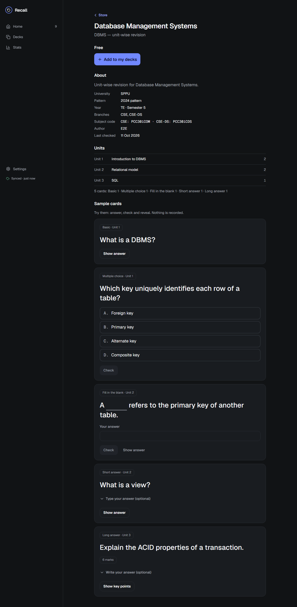         | 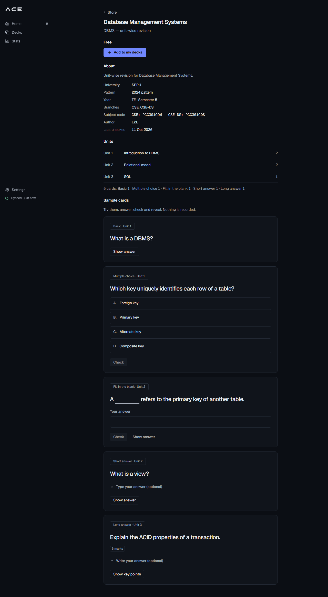         |
| Paid deck, phone           | 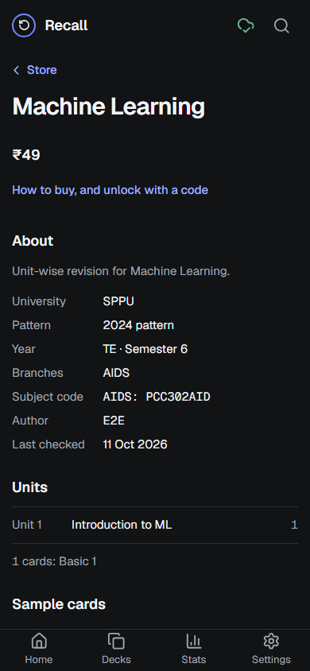          | 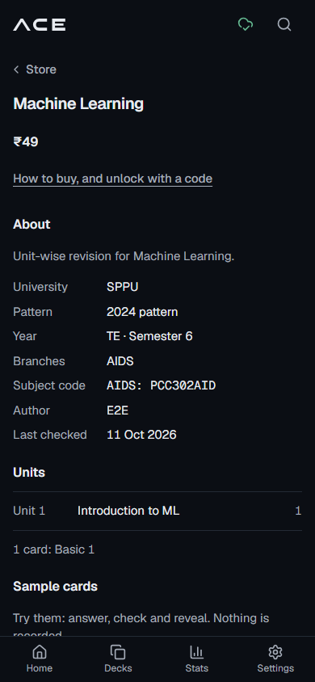          |
| Stats, desktop light       | 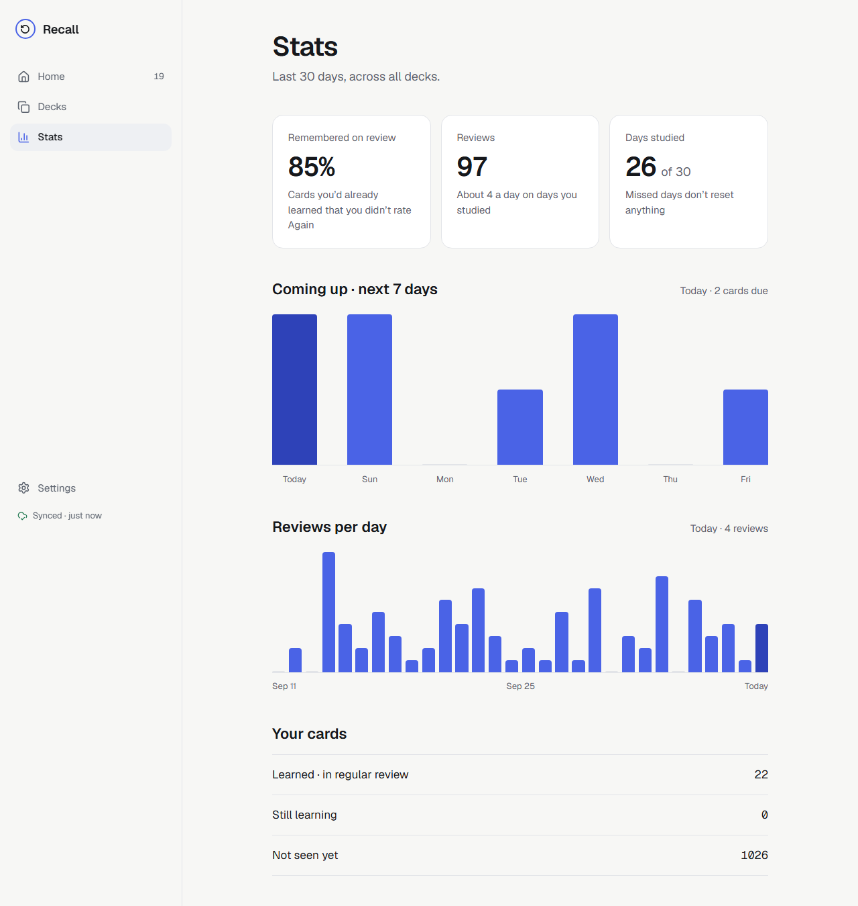             | 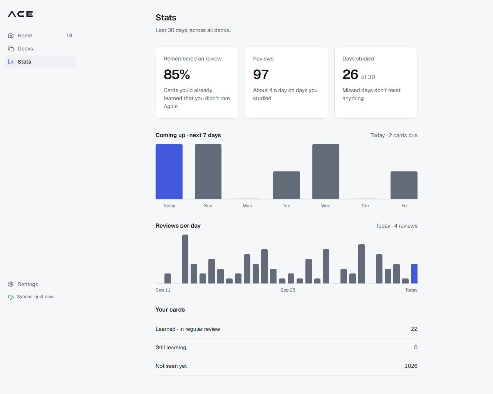             |
| Settings, desktop light    | 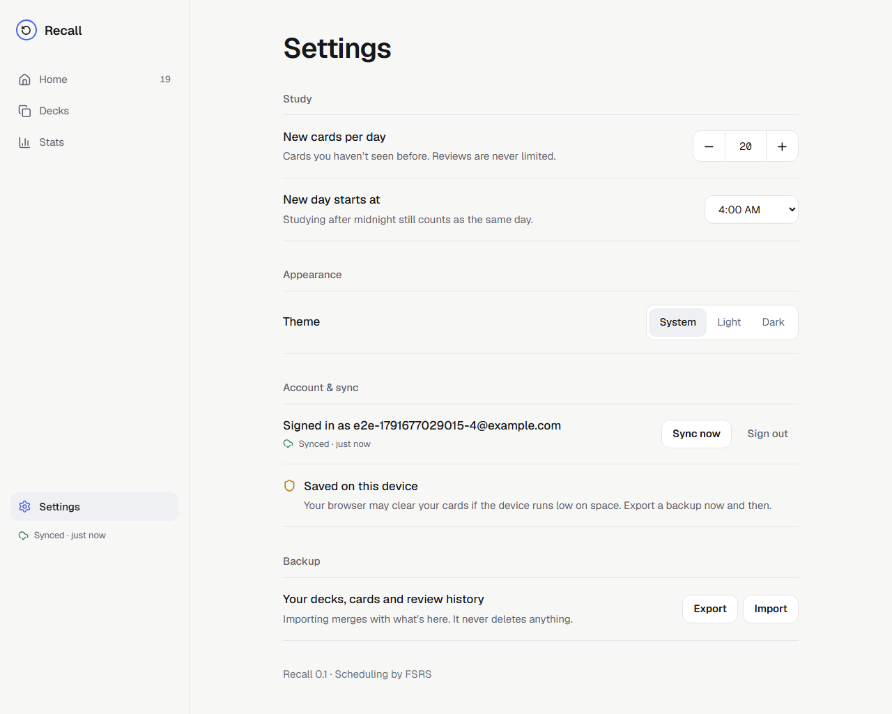          | 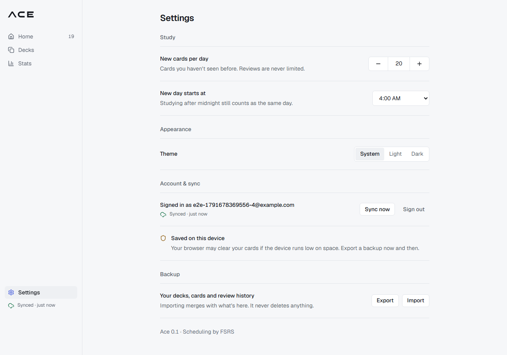          |
| Deck page, phone dark      | 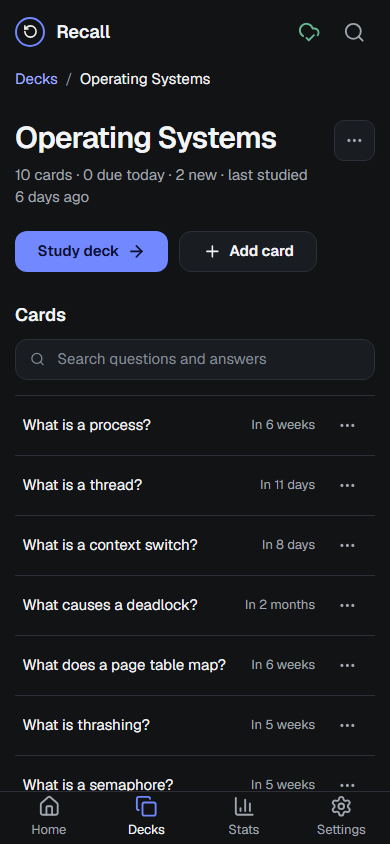         | 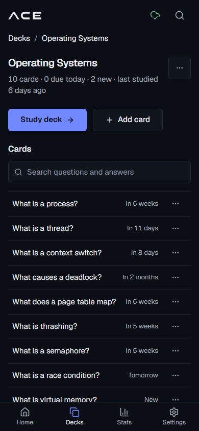         |

### What changed, against your targets

| Target                                                                      | Before                                                                                            | After                                                                               |
| --------------------------------------------------------------------------- | ------------------------------------------------------------------------------------------------- | ----------------------------------------------------------------------------------- |
| Body 14/15 · secondary 13 · meta 12                                         | body 15 (desktop bumped to 18), meta 13                                                           | body **15 phone / 14 desktop**, secondary **13**, meta **12**                       |
| Page title 20–22 · section 15–16                                            | 30, or 40 on desktop · 18–22                                                                      | **20 / 22** · **16 / 15**                                                           |
| Due count 32–36                                                             | 64 (mono)                                                                                         | **34** (Geist, tabular figures)                                                     |
| Review question 20–22 · answer 16–17                                        | 24, or 30 on desktop · 20–22                                                                      | **20 / 22** · **16 / 17**                                                           |
| Buttons 32–36 desktop, primary 36 · phone primary 44                        | 44–56 everywhere (really 41–52, see above)                                                        | desktop **36** primary and fields, **32** secondary, ghost and icon · phone **44**  |
| 4px base · section gaps 24 · panel padding 16–20 · rows 44–48               | 3.75px base · gaps 32–56 · padding 24–40 · rows 64–72                                             | **4px** · **24** · **16 / 20** · deck and card rows **48**                          |
| Radius 6 controls / 10 panels · hairlines · shadows only on overlays        | 8–12 / 16 · no overlay shadow                                                                     | **6 / 10** (tags 4) · 1px borders · a soft shadow only on dialogs, menus and toasts |
| Sidebar 200–220, nav items 32, text 13–14                                   | 272 · 44 · 15                                                                                     | **208** · **32** · **14**                                                           |
| Content ~680                                                                | 740                                                                                               | **680** (review 680, dialogs 384)                                                   |
| Rating buttons ~52, smaller undo pill                                       | 72 · 44px pill                                                                                    | **52** · a 28px pill (inside a 44px tap area on phones)                             |
| Neutral surfaces, `#0B0E14` base; accent only for primary, focus, selection | `#111315` base; accent on links, tags, icons, progress bar, chart bars, focus ring in text colour | `#0B0E14` / `#10141B` / `#171C24`; accent kept for the uses listed in D-346         |

## Final tokens (`apps/web/src/index.css`)

### Colour

| Token            | Dark      | Light     | Use                                            |
| ---------------- | --------- | --------- | ---------------------------------------------- |
| `bg`             | `#0B0E14` | `#F6F7F9` | page                                           |
| `surface`        | `#10141B` | `#FFFFFF` | panels, fields, rows on hover                  |
| `surface-raised` | `#171C24` | `#EEF0F3` | selected nav, pills, hovered controls          |
| `border`         | `#232A35` | `#E2E5EA` | hairlines                                      |
| `text`           | `#E8EBF0` | `#14171D` | primary text, links                            |
| `text-secondary` | `#A4ABB7` | `#565E6B` | secondary text                                 |
| `text-muted`     | `#8C94A1` | `#636B78` | meta, placeholders, chart bars                 |
| `accent`         | `#7188FF` | `#4159DD` | primary buttons, focus, selection, today's bar |
| `on-accent`      | `#0B0E14` | `#FFFFFF` | text on accent                                 |
| `success`        | `#65B891` | `#237A52` | correct, synced                                |
| `warning`        | `#E7B96C` | `#8F5E10` | offline, storage                               |
| `error`          | `#EF7A7A` | `#B23C3C` | wrong, errors, delete                          |

Contrast (computed, WCAG). Every text colour clears 4.5:1 on all three surfaces, and axe passes in both themes:

| Text on bg / surface / raised | Dark               | Light              |
| ----------------------------- | ------------------ | ------------------ |
| text                          | 16.2 / 15.4 / 14.3 | 16.7 / 18.0 / 15.7 |
| text-secondary                | 8.4 / 8.0 / 7.4    | 6.1 / 6.5 / 5.7    |
| text-muted                    | 6.3 / 6.0 / 5.6    | 5.0 / 5.4 / 4.7    |
| accent                        | 6.1 / 5.9 / 5.4    | 5.3 / 5.7 / 5.0    |
| success                       | 8.1 / 7.8 / 7.2    | 4.9 / 5.3 / 4.6    |
| warning                       | 10.6 / 10.2 / 9.4  | 5.2 / 5.6 / 4.9    |
| error                         | 7.1 / 6.8 / 6.3    | 5.4 / 5.8 / 5.1    |
| on-accent on accent           | 6.1                | 5.7                |

### Type, spacing and shape

| Token                    | Phone (<1024px) | Desktop | Line height |
| ------------------------ | --------------- | ------- | ----------- |
| `text-hero` (due count)  | 34              | 34      | 1.1         |
| `text-page`              | 20              | 22      | 1.25        |
| `text-card` (question)   | 20              | 22      | 1.35        |
| `text-answer`            | 16              | 17      | 1.55        |
| `text-section`           | 16              | 15      | 1.4         |
| `text-body`              | 15              | 14      | 1.5         |
| `text-small` (secondary) | 13              | 13      | 1.45        |
| `text-meta`              | 12              | 12      | 1.4         |

- **Spacing:** Tailwind's rem scale on a 16px root, so a 4px base.
- **Radii:** `sm` 4 (tags, keys), `md`/`lg` 6 (controls), `xl` 10 (panels, dialogs, toasts).
- **Shadow:** `shadow-overlay`, only on overlays (the `overlay` utility for dialogs and menus, plus toasts).
- **Controls:**
  - `btn` heights are 44 on phones and 32 on desktop; `btn-primary` and `field` are 36 on desktop.
  - `icon-btn` is 44 on phones and 32 on desktop.
  - Hover states are added on every button variant, icon button and row.
- **Browser surfaces:** an accent focus ring, accent-tinted text selection and tabular figures app-wide.

## What Impeccable flagged

- **Setup:** the context loader found no PRODUCT.md or DESIGN.md. It classed this as a scoped refinement of the existing UI, with the code as the design authority, and said to offer `/impeccable init` afterwards. It also asked for one decision checkpoint with you. Your overnight brief pinned every target, so I worked from it instead of stopping.
- **Detector:** `impeccable detect` ran once over the 23 changed UI files, and once over the same files before the polish for comparison. It reported **0 findings** both times.
- **Craft floor and polish playbook,** applied by inspection in two batched screenshot rounds (148 images each). Round 1 found:
  - **Stats:** charts were solid accent and 210px tall. Now neutral bars, accent only for today, and 144/128px tall.
  - **Store chips:** 40px pills wrapped "BE" onto its own line on a phone. Now 32px chips with a 44px tap area.
  - **Long answers:** the in-button "Suggested" grew the rating row to about 68px. The line above already says "Suggested: Good", so the word is now screen-reader-only.
  - **Paid deck:** "How to buy, and unlock with a code" no longer looked like a link once links went neutral. In-text links get an underline.
  - **Copy:** "1 cards" became "1 card".
  - **Settings and editor:** the segmented controls and the stepper were 44px on desktop. Now 32/36.
- **Round 2 (with the new layout guard):** every touch target was really 41px because of the 15px root (D-345). Also fixed: the Settings stepper (42px inside its border) and the chip tap areas. Round 2 confirmed the fixes, and I stopped there as the playbook asks.

## What I chose not to change

- **The visual identity:** Geist, the indigo accent hue, the semantic token names and the screens' structure. This was a polish, so the incumbent world stays (Impeccable's "refinement preserves" rule).
- **Two moments above the page-title size:** the Welcome headline is 26px (was 44) and "Review complete" 26px (was 40). They're the first-run and finish moments, so a 20–22px title would undersell them.
- **The phone tab bar** stays 56px tall with 20px icons: a thumb target, and the platform norm.
- **Monospace** stays where it means data: subject codes, the unlock-code field, keyboard keys and key-point numbers. It's gone from counts and the due number, which now use tabular Geist.
- **Light-theme chart bars** stay a mid grey (`#636B78`). A lighter grey would drop below 3:1 for graphics.
- **The toast** stays dark in both themes, as before.
- **Identifiers:** `recall.theme` (localStorage), the Dexie database name, `@recall/*`, the repo and the databases (D-344).
- **No domain, sync, API or database changes.** The only API change is the email sender name and subject the rebrand needed. `MAIL_FROM` on Render is untouched.
- **No PRODUCT.md or DESIGN.md.** Impeccable offers `/impeccable init` to record the product and this system. I didn't create them unasked.
- **Not updated:** a newer Impeccable (v4.5.2) is available. Updating it runs `npx impeccable update`; tell me if you want it.

## Tests

- **New:**
  - `e2e/m1-pwa.spec.ts` (rebrand): manifest name, colour and icon sizes (read from the PNGs); head title, theme colour, favicons and apple-touch-icon; icons precached by the service worker; Chrome installability; no "Recall" on any main screen; the wordmark is SVG, 14–16px tall.
  - `e2e/layout.spec.ts` (D-347): no sideways scroll and 44px tap areas at 390px on every main screen.
  - The mailer test now covers the sender name.
- **Changed:**
  - The PWA test expected `name: 'Recall'`. It now expects Ace and checks more.
  - The suggested rating's "Suggested" text is now screen-reader-only. The E2E assertion (`toContainText('Suggested')`) still passes on the same element.
- **Results:** `pnpm check`: core 327, API 129 and web 289 tests passing. `pnpm e2e`: see the deploy section. Axe in both themes passes.

## Deploy and live check

_Filled in after the deploy, below._
